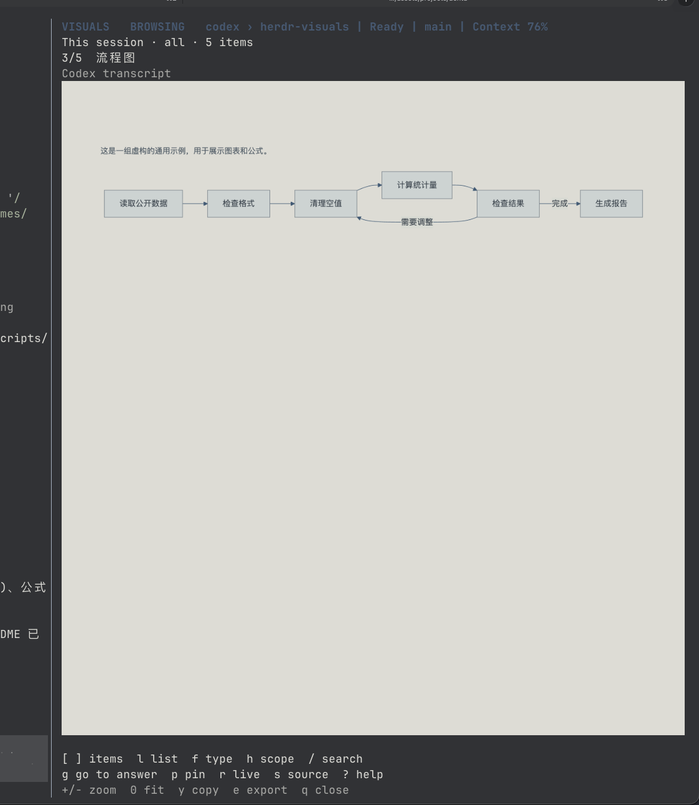
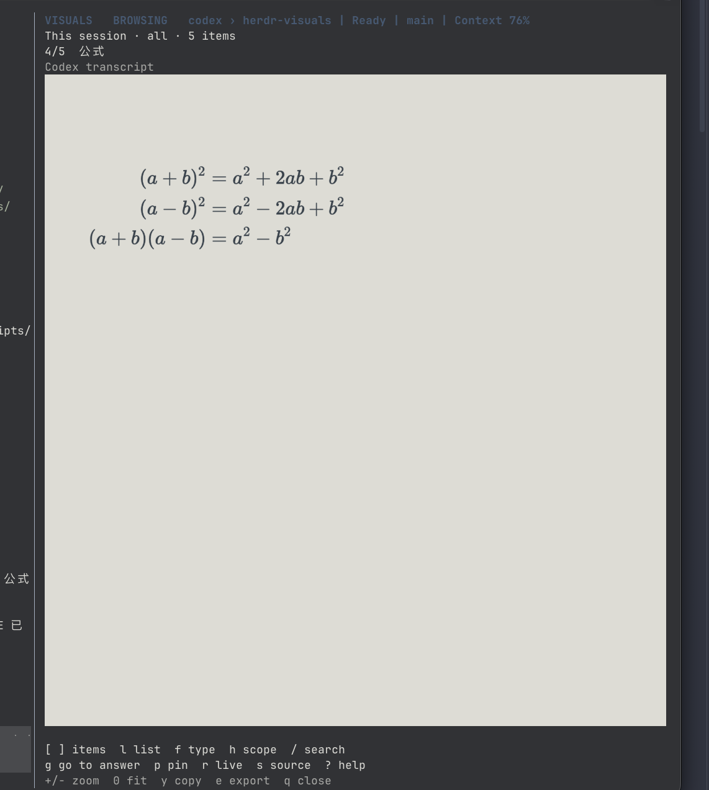
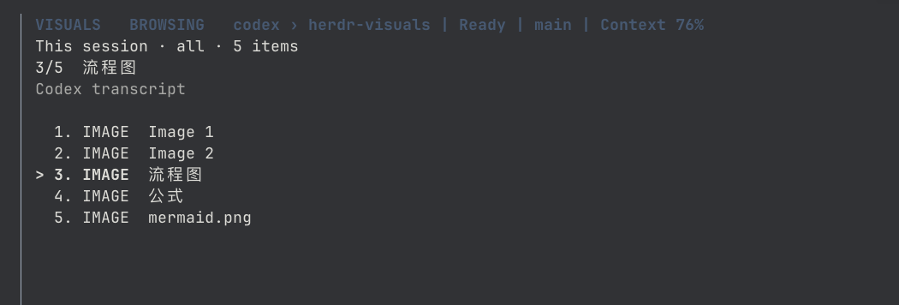

# Herdr Visuals

Preview Mermaid diagrams, LaTeX equations, and local images beside your omp,
Codex, Claude Code or pi conversation in a Herdr split pane. Open with **prefix+v**,
browse or pin an item, and keep working. Rendering runs locally, without a cloud
renderer, API key, or model call.

- Browse diagrams, equations, image links, and typed images returned by agent tools.
- Zoom, pan, inspect the original source, or jump to the containing answer.
- Search within the bound session and export the selected item as PNG and Markdown.

## Screenshots

Visuals running in Herdr: browsing a workflow image, viewing equations, and
selecting an item from the session list. The workflow and equations use
[the bundled fictional example](examples/overview.md).

**Workflow image preview**



**Equation image preview**



**Session item list**



Press `l` to open the list, `j` / `k` to select an item, and Enter to view it.

## Install

Requires Herdr 0.9.2+ (0.9.3 recommended), Node.js 22+, npm, and a
graphics-capable terminal such as Ghostty, kitty, or WezTerm. Herdr's `[terminal].kitty_graphics` must be enabled.

Install **0.2.0** for omp, Codex, Claude Code and pi support:

```sh
herdr plugin install hx-w/herdr-visuals --ref v0.2.0
```

For development, link a local checkout instead:

```sh
npm ci --ignore-scripts
npm run setup
herdr plugin link "$PWD"
```

Installation runs `npm ci --ignore-scripts` and downloads Playwright's pinned
Chromium runtime. Linux may require Chromium system libraries; install them
with your distribution's package manager (Playwright documents them via
`npx playwright install-deps chromium`). No daemon starts at login.

Add to your Herdr `config.toml`, then run `herdr server reload-config`:

```toml
[[keys.command]]
key = "prefix+v"
type = "plugin_action"
command = "hx-w.visuals.open"
description = "Visual previews"
```

`prefix` is your existing Herdr prefix, followed by `v`. This does not change
the prefix itself. From a local checkout, `node scripts/bind-key.mjs` adds this
binding, preserves other settings, backs up the file, and refuses conflicts.

Try the bundled diagram and three equations:

```sh
herdr plugin action invoke hx-w.visuals.example
```

Use `[` / `]` to browse, `0` to fit a wide diagram, and `s` to inspect its source.
To preview your conversation, open Visuals from the source agent pane with **prefix+v**.

For Codex versions that use a shared app-server daemon, put `thread-id` first in
the existing `[tui].status_line` array in your Codex `config.toml`. Keep your other
status items after it, for example:

```toml
[tui]
status_line = ["thread-id", "model-with-reasoning", "project-name"]
```

This displays the full current session ID in the live footer. New Codex panes
and new threads load this setting. Existing panes can keep using Herdr's exact
session binding. If an existing pane is disconnected, run `/status` in that pane
and bind its displayed Session ID with
`herdr pane report-agent-session <pane-id> --source herdr:codex --agent codex --agent-session-id <session-id>`.
Never substitute an ID found by matching the working directory.

### omp, pi and Claude Code bindings

Visuals uses Herdr's built-in integrations; it installs no additional hook.
Check `herdr integration status`. If your integration is absent, install the
matching one and restart that agent pane so it loads the hook:

```sh
herdr integration install omp
herdr integration install pi
herdr integration install claude
```

Run only the command for the agent you use. omp and pi must report an exact
absolute session-file path. ID-only or unsaved sessions cannot be discovered
automatically. Custom profiles/session directories work when Herdr reports
their actual file; Visuals never selects a session by project, title or recency.
An explicit binding, using the file known from that exact session, is also possible:

```sh
herdr pane report-agent-session <pane-id> --source herdr:omp --agent omp --agent-session-path /absolute/path/session.jsonl
herdr pane report-agent-session <pane-id> --source herdr:pi --agent pi --agent-session-path /absolute/path/session.jsonl
herdr pane report-agent-session <pane-id> --source herdr:claude --agent claude --agent-session-path /absolute/path/session.jsonl
```

Claude Code also accepts Herdr's exact session UUID. The adapter constructs one
filename using the official SDK's canonical project-directory encoding and
validates that file's session ID. A missing file or mismatched worktree fails
closed; no alternative session or project directory is searched.

## Interaction

- **prefix+v**: open beside the current pane; focus an existing preview in the
  current tab; close when pressed from the preview itself.
- The preview is bound to the session from which it was opened. Focusing
  another agent does not read that agent's history. Opening explicitly from a
  different source clears all old items and pins before reading the new session.
  Starting a new session in the same pane also clears the previous records.
- The preview starts with this session's records and the newest item selected.
  `h` switches to the latest turn's answers and images. Browsing, panning, zooming,
  or pinning holds the current item; `r` resumes live updates.
- There is no background discovery or automatic reopening while closed.

| Key | Action |
| --- | --- |
| `[` / `]` or `b` / `n` | Previous / next item |
| `l` | Show / hide the item list |
| `j` / `k`, Enter in list | Select an item and open it |
| `f` | Cycle all / diagrams / equations / images |
| `h` | Toggle this session's records / latest turn's answers and images |
| `/` | Search only this session by title, context, or source; Enter confirms |
| `p` | Pin the current item / resume following |
| `r` | Resume live updates within this session |
| `j` / `k`, arrow keys | Scroll vertically / pan horizontally in preview |
| `+` / `-` | Zoom |
| `0` | Fit the complete diagram to the pane width |
| `g` | Open the containing answer with this item highlighted |
| `s` | Toggle rendered / original source |
| `y` | Copy original source (macOS pbcopy, Linux wl-copy or xclip) |
| `e` | Export matching PNG and Markdown to `~/Downloads/herdr-visuals/` |
| `q` / Escape | Close preview |
| `?` | Show / hide keyboard help |

Press `g` on an item to open its containing answer with the item highlighted.
Use `j`/`k`, Page Up/Down, or Home/End to read it; `g` or Escape returns to the
preview. Selected text and Markdown files open their own context. Context stays
bound to the captured item and is cleared on source/session changes. No
conversation content is written to disk.

This version does not scroll the source terminal. Herdr 0.9.0 exposes pane-wide
search and scrolling, but no session-scoped terminal range or atomic
session-identity guard. A pane can contain multiple sessions, so matching terminal
text alone cannot reliably identify the item's original location. Visuals reads
only the bound transcript and uses its message identity and line number instead.

Wide diagrams start at readable size and can be panned; `0` gives an overview.
The preview uses a neutral light palette and renders at twice CSS resolution
for high-DPI terminals.

Selected text, when supplied by Herdr's invocation context, takes precedence
over transcript discovery. This also accepts bare Mermaid or raw math explicitly
selected by the user. Press `r` to return to the session.

## What gets rendered

- Complete fenced `mermaid` blocks.
- Display math delimited by `$$ ... $$` or `\[ ... \]`.
- Fenced `math`, `latex`, and `tex` blocks.
- Local image references: Markdown images, clickable image links, backtick paths,
  and bare absolute paths. PNG, JPEG, WebP, GIF, BMP, AVIF, and SVG are supported.
  Relative links resolve against the source session's working directory; `~/`
  and `file://` links also work. Angle-bracket Markdown destinations preserve spaces.

For example, `[Chart](</path/sample chart.png>)` appears as an image in Visuals.
Images displayed by Codex tools (including `Viewed Image` and images returned
through an `exec` call) also appear, even without a link in the final answer.
Visuals uses the embedded image content in the bound conversation, so these
previews keep working if the original temporary file is gone. Tool code is never
executed or searched for image paths. Embedded images can be exported with `e`;
`g` shows image context, and `y` explains how to export instead of copying Base64.
Images use the same navigation, filtering, pinning, zoom/pan and export controls.
Completed Codex image-generation records also appear directly, including the
original image behind a `Saved to: file://...` notice. Visuals prefers the embedded
original and uses the typed saved path when pixels are absent. It does not search
arbitrary tool logs for paths, and the matching tool-result preview is not repeated.
Large images automatically fit the preview area. Previews stream as standard
Kitty graphics in 4 KiB Base64 chunks, preserving
pixel resolution without the removed socket API's image/request limits.
Zoom, pan, and export retain their original resolution.
Valid images are no longer rejected solely for exceeding
32 MiB or 40 megapixels; decoding remains subject to browser and available memory.

Animated formats are captured as a static preview. HTTP image URLs are not
downloaded automatically. Missing or unsupported files show an explicit error.

### Native Kitty graphics

All previews write standard Kitty graphics into the Visuals terminal. Herdr
renders them natively and handles placement in the attached terminal. The plugin
uses no `pane.graphics` socket methods, `icat`, or shared client file paths.
Images are anchored below the header and removed when opening text/list views,
changing to an empty scope, or closing the viewer. Terminal cell-size reports
adapt rendering to the attached client's DPI; terminals without reports use a
standard 1:2 cell ratio.

Image files are read on the server, so remote previews do not need client access
to their paths. Remote display has not been live-tested. If the terminal cannot
display Kitty graphics, press `s` for source view.

Inline math stays in prose and does not create separate items. Ordinary code
fences are skipped. Incomplete blocks wait for completion; rendering errors
show the source and the parser error instead of silently changing the input.
Use `aligned` inside math delimiters for multi-line derivations.

Codex is resolved using the full ID in the configured live footer, or the exact
`agent_session` ID reported by Herdr. The footer reader checks only the last three
visible rows of the selected pane; it never searches scrollback or guesses by cwd.
For paginated Codex history, Visuals connects read-only to the already-running
local app-server and requests only that ID's metadata and items. It never lists,
starts, resumes, or modifies threads. Older sessions use their exact JSONL file.
An active history API failure shows an error instead of silently showing a stale
JSONL snapshot.

The Codex adapter reads assistant final messages, typed tool images, viewed image paths,
and completed image-generation records. Prompts, tool text, commentary and
internal reasoning are excluded. History keeps the newest 1,000 API items within
a 16 MiB budget (the final complete item may exceed it), then at most 300
answer/image records. Partial history is labeled. Explicit selected-text preview
remains available.

omp and pi use the current v3 JSONL tree format; older journal versions are not
migrated or supported. Visuals follows the last persisted leaf's `parentId`
ancestry, not physical adjacency or branch-summary hints. Only
successful assistant final text and typed output images are shown. omp's
externalized images load the referenced content-addressed blob from one agent
directory; generated images use retained payloads rather than temporary copies.
The journal does not persist pointer-only branch navigation, so the preview
changes branch when the agent next appends a record, not immediately on `/tree`.

Claude Code follows `uuid`/`parentUuid` main-session ancestry, excluding sidechains,
subagents, prompts, thinking, tool logs and raw streaming deltas. Complete
assistant blocks sharing an API message ID are grouped; a tool-use block
suppresses that group's text. Claude can persist text before the later tool
block arrives, so that text is reclassified on the next append rather than
claimed as certified whole-turn completion. Typed base64 tool-result images
must match a tool call on the selected branch.

File-backed sources retain at most 300 visual-bearing entry payloads under a
16 MiB budget, allowing one complete oversized image; resolved omp blob pixels
also count toward the snapshot budget. Ignored whitespace and known Claude
tool commentary do not consume retained answer history. Ancestry remains in a
compact in-memory index; its size is linear in journal entries. Unchanged
polls reuse the snapshot; appended complete lines are decoded incrementally.
Reads of each file are serialized across polling and answer navigation.
Truncation, inode/session replacement, option changes or changed prefix/tail
guards rebuild the parser. These readers consume append-only agent journals,
not arbitrarily edited files. In-progress JSONL and UTF-8 fragments are buffered.

If Visuals says **Codex session is not connected**, Herdr has not supplied the
source pane's session identity. Configure the Codex footer as described above or
check `herdr integration status` and the SessionStart binding. With a shared Codex
daemon, hooks can inherit the daemon's old pane environment instead of the current
TUI's pane. This is different from a connected session containing
no visual items, or an identified transcript that cannot be found. Visuals retries
the bound pane automatically when its identity becomes available; it never guesses
from the working directory. Selected-text previews still work while disconnected.

Only the active source is read. Conversation text is kept in process memory;
source pane handles are stored in the plugin state directory. Files are saved
only when you press export. Mermaid uses strict mode; KaTeX disables trusted
commands; Chromium can fetch only bundled rendering assets through an intercepted
virtual origin. External network requests and arbitrary local file loads are blocked.

Optional environment variables:

| Variable | Purpose |
| --- | --- |
| `HERDR_VISUALS_CODEX_HOME` | Custom Codex home; otherwise `CODEX_HOME`, then `~/.codex` |
| `HERDR_VISUALS_OMP_HOME` | omp agent directory for blobs; otherwise `PI_CODING_AGENT_DIR`, managed session-file hierarchy, then `~/.omp/agent` |
| `CLAUDE_CONFIG_DIR` | Claude Code config directory for exact-UUID file resolution; otherwise `~/.claude` |
| `HERDR_VISUALS_EXPORT_DIR` | Export parent directory; otherwise `~/Downloads` |

## Source architecture

```text
src/
  sources/
    index.mjs          Adapter registry and fail-closed coordination
    contract.mjs       SourceSnapshot/SourceAdapter contract and binding helpers
    files.mjs          Read-only streaming, incremental decode and file cache
    codex/
      index.mjs        Exact thread binding and live footer identity
      history.mjs      Restricted read-only app-server transport
      rollout.mjs      Codex record normalization
    claude/
      index.mjs        Exact path/UUID binding
      format.mjs       Main-session ancestry and complete-block normalization
    omp/index.mjs      omp binding, blob storage and generated-image policy
    pi/
      index.mjs        pi binding
      format.mjs       Shared omp/pi ancestry and typed-content normalization
  viewer.mjs           TUI and captured source-pane lifecycle
  model.mjs            Navigation, filtering, pin/follow state
  render.mjs           Local Chromium/Mermaid/KaTeX rendering
  graphics.mjs         Kitty transport and terminal input
  launch.mjs           Herdr action and pane lifecycle
```

Adapters expose `agent`, `label`, `resolvePane(pane)`, `read(pane)` and optional
`close()`. They never query focus or select unrelated sessions. `resolvePane`
adds the persisted session identity; pane/terminal, agent, reference kind/value
and that identity form the viewer's invalidation key. `read` returns the uniform
`SourceSnapshot` of answer/image records, origin, partial-history flag and issue.
The viewer has no source-format branches.

To add an agent, implement its exact binding and normalization in
`src/sources/<agent>/`, register it in `sources/index.mjs`, and add fictional
fixtures for isolation, appends, replacement, errors and real PTY rendering.
The 0.2.0 cutover removes the old mixed source modules without compatibility
re-exports. This cutover adds no dependency, daemon or model API credential.

## Development and verification

```sh
npm ci --ignore-scripts
npm run setup
npm run check
herdr plugin link "$PWD"
node scripts/bind-key.mjs
herdr server reload-config
```

`npm run check` exercises the supplied preview example with real Chromium,
Mermaid and KaTeX, including graph structure, fraction/aligned math layout,
raw-source errors, all four session adapters, typed images, append/branch
boundaries, same-path replacement and pin/follow behavior. Real PTY scenarios
decode the complete Kitty PNG output. Rendered test images go to ignored
`test-output/`. CI runs the same checks on Linux.

For manual acceptance, open the example, navigate through its four items,
filter, pin, browse history, zoom/pan, toggle source, export, resize, then close
and reopen. Check that switching to an empty scope clears the old image and
that exporting immediately after changing items exports the selected item.

Uninstall with `herdr plugin uninstall hx-w.visuals` (or `plugin unlink` for a
local checkout), and remove only the `hx-w.visuals.open` keybinding. Existing
exports and the config backup remain yours. No agent session files are modified.
